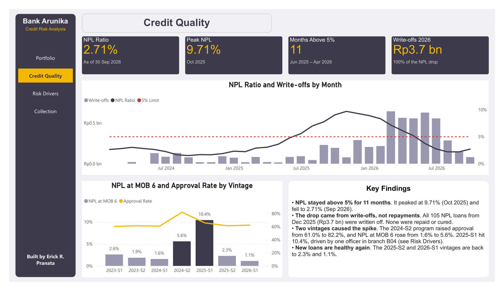
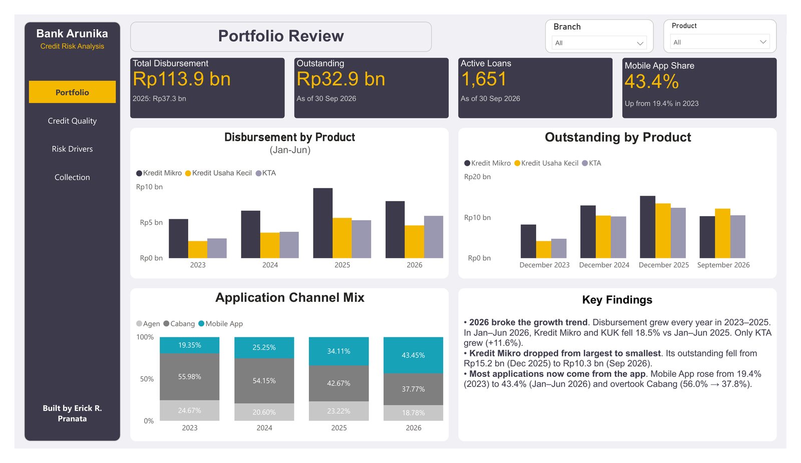
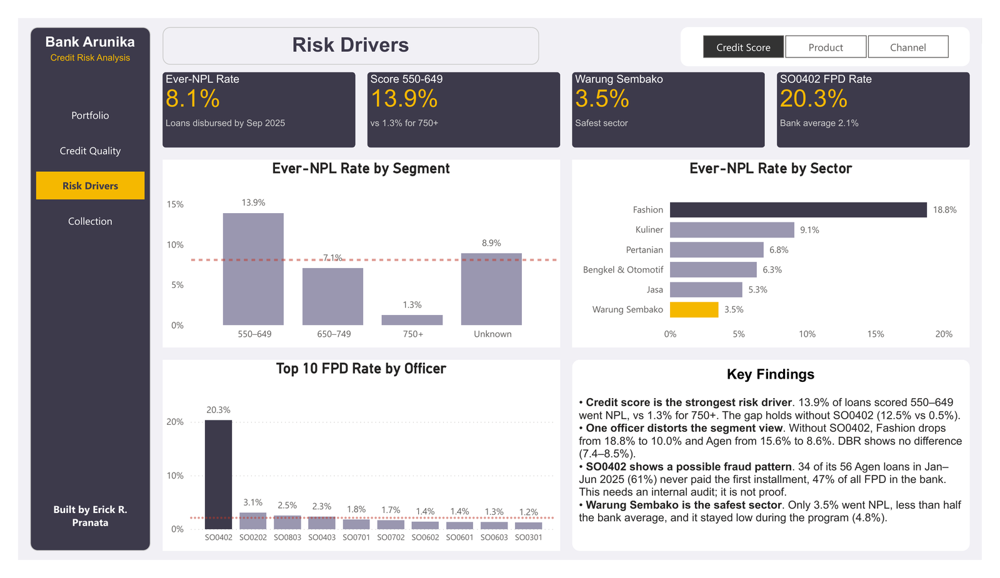
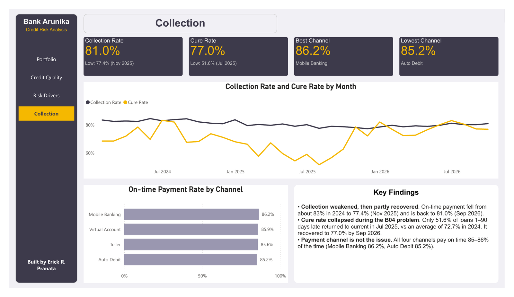

# Bank Arunika Credit Risk Analysis 2023–2026

**PostgreSQL · SQL · Power BI · DAX** — studi kasus analisis risiko kredit dan penagihan untuk bank fiktif, data Jan 2023 – Sep 2026.



**File proyek:** [Dashboard (PDF)](dashboard/Bank_Arunika_Dashboard.pdf) · [Deck presentasi (PDF)](deck/Bank_Arunika_Analisis_Risiko_Kredit.pdf) · [File Power BI](dashboard/Bank_Arunika.pbix) · [Tabel master (SQL)](sql/01_table_master.sql) · [Data quality log](docs/data_quality_log.md)

## Project Overview

Bank Arunika adalah bank fiktif dengan 3 produk kredit: Kredit Mikro, Kredit Usaha Kecil (KUK), dan KTA, dengan outstanding Rp32,9 miliar per Sep 2026.

NPL gross bank naik di atas batas aman 5% pada Jun 2025, memuncak di **9,71%** pada Okt 2025 (hampir dua kali batas aman), dan bertahan di atas 5% selama 11 bulan. Head of Credit Risk meminta jawaban untuk tiga pertanyaan:

1. Kenapa NPL melonjak di 2025?
2. Apakah penurunan NPL di 2026 nyata?
3. Apa yang harus diubah di 2027?

Data diolah dengan SQL di PostgreSQL untuk membuat tabel master, lalu dianalisis dan divisualisasikan dalam dashboard Power BI 4 halaman. Hasilnya dirangkum dalam deck 8 slide untuk Head of Credit Risk.

## Executive Summary

- **Kenapa NPL melonjak:** dua penyebab bertumpuk, yaitu program pelonggaran approval (Jul–Des 2024) dan satu petugas kredit (SO0402) yang 61% kredit jalur Agen-nya pada Jan–Jun 2025 tidak pernah membayar cicilan pertama. Tanpa kedua penyebab ini, NPL Okt 2025 hanya **2,18%**.
- **Apakah penurunan 2026 nyata:** belum. **100%** penurunannya berasal dari hapus buku; tidak ada satu pun dari 105 kredit NPL per Des 2025 yang lunas atau kembali lancar. Kabar baiknya, angkatan kredit terbaru sudah sehat (1,1% NPL di umur 6 bulan).
- **Apa yang diubah di 2027:** saring pemohon skor 550–649 dengan standar normal saat ada program, pasang alarm FPD per petugas dan agen, dan tagih nasabah sejak DPD 1–7. Dua kebijakan pertama saja bisa menghindari sekitar **Rp1,3 miliar** write-off.

## Objectives

Tiga pertanyaan Head of Credit Risk dijawab lewat 10 pertanyaan bisnis dari brief:

1. Bagaimana pertumbuhan pencairan dan outstanding per produk?
2. Bagaimana komposisi channel pengajuan berubah?
3. Bagaimana tren NPL bulanan, dan bulan apa saja di atas 5%?
4. Berapa bagian penurunan NPL 2026 yang berasal dari hapus buku?
5. Angkatan kredit mana yang paling buruk, dan apa pembedanya?
6. Apa efek Program Akselerasi UMKM?
7. Segmen mana yang paling berisiko?
8. Adakah cabang, petugas, atau channel yang tidak wajar?
9. Bagaimana collection rate dan cure rate?
10. Tiga kebijakan apa yang perlu diubah di 2027?

Bonus: bagaimana performa sektor Warung Sembako?

## Hipotesis Awal

Hipotesis dibuat sebelum data disiapkan, lalu diuji dengan data.

| Hipotesis | Hasil setelah diuji |
| --- | --- |
| Lonjakan NPL karena kesalahan input data | **Tidak terbukti.** 34 temuan kualitas data dicatat dan ditangani, tapi lonjakan NPL tetap ada. |
| Lonjakan NPL karena manipulasi data | **Ada indikasi.** Satu petugas (SO0402) punya 61% FPD di kredit jalur Agen (Jan–Jun 2025). Ini perlu diaudit. |

**Temuan di luar dugaan:** program pelonggaran approval ikut memicu lonjakan NPL.

## Dataset

Data dari brief berisi 7 tabel, periode Jan 2023 – Sep 2026. Data bersifat fiktif untuk keperluan studi kasus, dan data mentah tidak disertakan di repository ini.

| Tabel | Satu baris = | Baris mentah | Setelah cleaning | Dipakai |
| --- | --- | --- | --- | --- |
| `customers` | satu nasabah (pemohon kredit) | 4.838 | 4.802 | Ya |
| `loan_applications` | satu pengajuan (disetujui, ditolak, atau batal) | 5.260 | 5.260 | Ya |
| `loans` | satu kredit yang cair | 3.430 | 3.420 | Ya |
| `repayments` | satu cicilan jatuh tempo | 52.832 | 52.634 | Ya |
| `loan_monthly_snapshot` | satu kredit di satu akhir bulan (sisa pokok, DPD, status) | 55.454 | 55.434 | Ya |
| `branches` | satu cabang | 8 | – | Tidak |
| `sales_officers` | satu petugas kredit | 24 | – | Tidak |

`branches` dan `sales_officers` hanya berisi nama dan lokasi. Kode cabang dan kode petugas sudah ada di tabel utama, jadi kedua tabel ini tidak diperlukan dalam analisis.

### Primary Keys

* `customers`: `customer_id`
* `loan_applications`: `application_id`
* `loans`: `loan_id`
* `repayments`: `payment_id` (satu cicilan unik = `loan_id` + `installment_no`)
* `loan_monthly_snapshot`: `loan_id` + `snapshot_date`

### Table Relationships

* `customers` → `loan_applications`: one-to-many (5.260 pengajuan dari 4.802 nasabah)
* `loan_applications` → `loans`: one-to-one, hanya untuk pengajuan yang disetujui (3.420 dari 5.260 pengajuan)
* `customers` → `loans`: one-to-many (3.420 kredit dari 3.186 nasabah)
* `loans` → `repayments`: one-to-many
* `loans` → `loan_monthly_snapshot`: one-to-many

### Table Master

Tabel master (schema `mart`) dibuat dari data yang sudah bersih dan ditambah kolom bantu, supaya pertanyaan bisnis bisa dijawab dengan query yang pendek. Rumus lengkapnya ada di [sql/01_table_master.sql](sql/01_table_master.sql).

| Tabel master | Kolom bantu | Rumus / arti |
| --- | --- | --- |
| `mart.loan_applications` | `kelompok_skor` | Skor kredit dikelompokkan: < 550, 550–649, 650–749, 750+, Tidak diketahui |
| | `flag_disetujui` | 1 jika status `APPROVED`, selain itu 0 |
| | `bulan_pengajuan` | Tanggal pengajuan dibulatkan ke awal bulan |
| `mart.loan_monthly_snapshot` | `kolektibilitas` | 1–5 berdasarkan DPD: 0 / 1–90 / 91–120 / 121–180 / > 180 hari |
| | `flag_npl` | 1 jika DPD > 90 hari (kolektibilitas 3–5) |
| | `vintage` | Bulan kredit cair (angkatan kredit) |
| | `mob` | Umur kredit dalam bulan sejak cair (month on book) |
| `mart.loans` | `flag_fpd` | 1 jika cicilan pertama tidak pernah dibayar |
| | `pernah_npl` | 1 jika kredit pernah NPL di salah satu bulan |
| | `dpd_terburuk` | DPD tertinggi sepanjang umur kredit |
| | `status_akhir` | Status di snapshot terakhir: `ACTIVE`, `CLOSED`, atau `WRITE_OFF` |
| `mart.npl_bulanan` | `npl_persen` | Outstanding NPL ÷ total outstanding × 100, tanpa kredit yang sudah dihapus buku |
| | `outstanding_write_off` | Sisa pokok kredit yang dihapus buku pada bulan itu |
| `mart.customers` | – | Salinan data nasabah yang sudah bersih |

Dua metrik yang membandingkan antarbulan dibuat sebagai SQL view di [sql/03_dashboard_views.sql](sql/03_dashboard_views.sql): `mart.v_vintage_semester` (NPL di MOB 6 dan approval rate per semester) dan `mart.v_collection_bulanan` (collection rate dan cure rate per bulan).

## Tools

* **PostgreSQL** — data cleaning, pembuatan tabel master, dan analisis dengan SQL (CTE, CASE WHEN, FILTER, window function, dan view).
* **Power BI** — dashboard interaktif 4 halaman dengan measure DAX dan field parameter.
* **Excel** — data quality log.
* **GitHub** — dokumentasi dan penyimpanan kode SQL.

## Data Processing

Analisis dikerjakan dalam 5 langkah:

1. **Data Understanding:** memeriksa satu baris mewakili apa, primary key, dan hubungan antartabel.
2. **Data Cleaning:** 34 temuan kualitas data dicatat dan ditangani di schema `clean`.
3. **Data Preparation:** membuat tabel master (schema `mart`) dengan kolom bantu seperti flag NPL, flag FPD, MOB, dan angkatan.
4. **Data Analysis:** menjawab 10 pertanyaan bisnis dengan SQL, lalu menguji kesimpulannya dengan uji validasi dan uji ketahanan (hasil diulang tanpa petugas SO0402).
5. **Data Visualization:** dashboard Power BI 4 halaman. Metrik yang rumit (angkatan, collection rate, cure rate) dihitung di SQL view, metrik sederhana dengan measure DAX.

**Data processing workflow:**

```text
staging (7 tabel mentah)
   │   data cleaning: 34 temuan
   ▼
clean (5 tabel bersih)
   │   01_table_master.sql
   ▼
mart (tabel master)
   ├── 02_analysis_queries.sql  ──►  jawaban 10 pertanyaan bisnis
   └── 03_dashboard_views.sql   ──►  v_vintage_semester, v_collection_bulanan
                │
                ▼
        Power BI (4 halaman)
                │
                ▼
         Deck 8 slide
```

### Data Cleaning

Setiap masalah di data mentah dicatat di [data quality log](docs/data_quality_log.md): **34 temuan** di 5 tabel utama, masing-masing dengan contoh, jumlah baris, dan tindakannya.

| Kategori | Jumlah temuan | Contoh |
| --- | --- | --- |
| Duplikat | 3 | 10 kredit tercatat dua kali (3.430 → 3.420 baris); 198 cicilan tercatat ganda (*double posting*) |
| Penulisan | 9 | Channel ditulis "MobileApp", "agen", "cabang "; kota ditulis "Jaktim", "Kota Bandung" |
| Format | 4 | Penghasilan berbentuk teks "Rp 10.350.000"; suku bunga campur desimal (0.1604) dan persen (19.67) |
| Rentang | 9 | Nominal pengajuan dan sisa pokok bernilai negatif; skor kredit di luar 300–850; tahun pengajuan salah ketik jadi 2027 |
| Kosong | 9 | DPD kosong di 111 rapor bulanan dihitung ulang dari data cicilan; kolom yang memang wajar kosong dibiarkan |

Lima dari 34 temuan ternyata wajar setelah diperiksa (misalnya sektor usaha kosong karena nasabahnya karyawan), jadi dibiarkan apa adanya.

## Metric Definitions

| Metric | Definition |
| --- | --- |
| NPL (gross) | Outstanding kolektibilitas 3–5 (telat lebih dari 90 hari) dibagi total outstanding, tanpa kredit yang sudah dihapus buku. Batas aman: 5%. |
| Ever-NPL rate | Persen kredit yang pernah menjadi NPL, untuk kredit yang cair sampai Sep 2025 (minimal 12 bulan riwayat). |
| FPD (first payment default) | Cicilan pertama tidak pernah dibayar. |
| MOB / vintage | Umur kredit dalam bulan sejak cair / semester saat kredit cair (contoh: 2025-S1 = Jan–Jun 2025). |
| NPL di MOB 6 | Persen kredit satu angkatan yang sudah NPL di umur 6 bulan, supaya angkatan dibandingkan di umur yang sama. |
| Collection rate | Persen cicilan jatuh tempo yang dibayar paling lambat di tanggal jatuh tempo. |
| Cure rate | Persen kredit yang telat 1–90 hari bulan lalu dan kembali lancar bulan ini. |

## Dashboard dan Key Findings

Dashboard Power BI 4 halaman. Susunan setiap halaman sama: card angka utama di atas, grafik bukti di tengah, dan Key Findings di kanan bawah. Teks dashboard memakai bahasa Inggris.

### 1. Portfolio



**Menjawab pertanyaan 1–2.**

**Key Metrics:** Total Disbursement, Outstanding, Active Loans, Mobile App Share, Disbursement by Product (Jan–Jun), Outstanding by Product, Application Channel Mix.

**Key Findings:**

1. **Pencairan naik terus sampai 2025, lalu melambat di 2026.** Pencairan Jan–Jun naik dari Rp10,6 miliar (2023) ke Rp20,8 miliar (2025), lalu turun 10,8% di 2026. Kredit Mikro dan KUK turun 18,5%, hanya KTA yang naik (11,6%).
2. **Kredit Mikro dari terbesar jadi terkecil.** Outstanding turun dari Rp15,2 miliar (Des 2025) ke Rp10,3 miliar (Sep 2026).
3. **Mobile App jadi channel utama.** Naik dari 19,4% pengajuan (2023) ke 43,4% (Jan–Jun 2026). Cabang turun dari 56,0% ke 37,8%.

Pencairan dibandingkan per Jan–Jun setiap tahun karena pencairan terakhir tercatat 9 Jul 2026.

### 2. Credit Quality


**Menjawab pertanyaan 3–6.**

**Key Metrics:** NPL Ratio, Peak NPL, Months Above 5%, Write-offs 2026, NPL Ratio and Write-offs by Month, NPL at MOB 6 and Approval Rate by Vintage.

**Key Findings:**

1. **NPL di atas 5% selama 11 bulan.** Di atas batas dari Jun 2025 sampai Apr 2026, puncaknya 9,71% (Okt 2025), lalu turun ke 2,71% (Sep 2026).
2. **Penurunan NPL 100% karena hapus buku.** Seluruh 105 kredit NPL per Des 2025 (Rp3,66 miliar) dihapus buku sampai Sep 2026. Tidak ada yang lunas atau kembali lancar.
3. **Dua angkatan bermasalah.** 2024-S2 adalah angkatan program pelonggaran (approval naik dari 61,0% ke 82,2%, NPL di MOB 6 naik dari 1,6% ke 5,6%). 2025-S1 mencapai 10,4% NPL di MOB 6 karena masalah di cabang B04. Angkatan terbaru sudah normal lagi (2,3% dan 1,1%).

Efek program (pertanyaan 6): untuk skor 550–649, approval naik dari 51,5% ke 86,9%. Kredit program mencapai 9,5% NPL di umur 12 bulan, dibanding 4,6% sebelum program.

### 3. Risk Drivers



**Menjawab pertanyaan 7, 8, dan bonus.**

**Key Metrics:** Ever-NPL Rate, Score 550–649, Warung Sembako, SO0402 FPD Rate, Ever-NPL Rate by Segment (bisa diganti: Credit Score, Product, Channel), Ever-NPL Rate by Sector, Top 10 FPD Rate by Officer.

**Key Findings:**

1. **Skor kredit adalah pembeda risiko terkuat.** 13,9% kredit skor 550–649 pernah NPL, dibanding 1,3% di skor 750+ (rata-rata bank 8,1%). Perbedaannya tetap ada tanpa SO0402 (12,5% vs 0,5%).
2. **SO0402: 61% kredit Agen gagal bayar cicilan pertama.** 34 dari 56 kredit jalur Agen pada Jan–Jun 2025 tidak pernah membayar cicilan pertama, setara 47% dari seluruh FPD bank. Ini indikasi untuk audit internal, bukan bukti kecurangan.
3. **Warung Sembako sektor paling aman.** Hanya 3,5% pernah NPL, kurang dari separuh rata-rata bank, dan tetap rendah saat program (4,8%). Fashion paling berisiko (18,8%), tapi turun ke 10,0% tanpa SO0402.

Jalur Agen (15,6%) dan Kredit Mikro (9,2%) juga paling berisiko di kelompoknya. DBR (rasio cicilan terhadap penghasilan) tidak membedakan risiko (7,4–8,5%).

### 4. Collection



**Menjawab pertanyaan 9.**

**Key Metrics:** Collection Rate, Cure Rate, Best Channel, Lowest Channel, Collection Rate and Cure Rate by Month, On-time Payment Rate by Channel.

**Key Findings:**

1. **Cure rate sempat anjlok.** Turun dari rata-rata 72,7% (2024) ke titik terendah 51,6% (Jul 2025), tepat di periode masalah cabang B04, lalu pulih ke 77,0% (Sep 2026).
2. **Collection rate kembali ke 81,0%.** Sempat turun dari sekitar 83% (2024) ke 77,4% (Nov 2025).
3. **Channel bayar bukan penyebabnya.** Keempat channel membayar tepat waktu 85–86% (Mobile Banking 86,2%, Auto Debit 85,2%). Masalahnya ada di cara menangani kredit yang mulai telat.

## Uji Validasi

Kalau kredit dari dua penyebab dikeluarkan, NPL Okt 2025 turun dari 9,71% ke **2,18%**, mendekati kondisi normal Des 2024 (2,32%). Dua penyebab ini menjelaskan 85% outstanding NPL di puncak.

## Insight dan Rekomendasi

| Insight | Rekomendasi untuk 2027 | Perkiraan dampak |
| --- | --- | --- |
| **Program meloloskan pemohon berisiko.** Approval skor 550–649 naik dari 51,5% ke 86,9%, padahal skor adalah pembeda risiko terkuat. | **Saring skor 550–649 dengan standar normal.** Saat ada program: plafon lebih kecil atau verifikasi tambahan, dan uji coba program baru dulu. | ≈ Rp0,5 miliar write-off terhindar |
| **Satu petugas (SO0402) menyumbang 47% FPD bank.** Tanpa dua penyebab ini, NPL Okt 2025 hanya 2,18%. | **Pasang alarm FPD per petugas dan agen.** Tahan pengajuan jika FPD di atas 5%; verifikasi independen untuk jalur Agen. | ≈ Rp0,8 miliar write-off terhindar |
| **Penurunan NPL 2026 100% dari hapus buku.** Tidak ada kredit yang pulih setelah telat 90 hari; cure rate sempat 51,6%. | **Tagih sejak DPD 1–7, lalu jalankan recovery.** Strategi per kelompok DPD; target cure rate kembali ke 72% atau lebih. | ≈ Rp0,42 miliar recovery (asumsi 10% tertagih) |

Dua rekomendasi pertama saja bisa menghindari **≈ Rp1,3 miliar** write-off.

**Ukuran yang dipantau setiap bulan:**

1. Approval rate per kelompok skor dan NPL angkatan di MOB 6 (maksimal 2,6%).
2. FPD per petugas dan agen (alarm di atas 5%).
3. Cure rate (minimal 72%) dan collection rate tepat waktu (minimal 83%).

Dampak dihitung mundur dari data 2024–2025, dan target disamakan dengan kondisi sehat bank di 2024.

## Limitations

- Bank Arunika adalah bank fiktif; datanya adalah dataset studi kasus.
- Temuan SO0402 adalah indikasi dari pola data, bukan bukti kecurangan.
- Tidak ada data recovery dan CKPN; recovery 10% adalah asumsi.
- Angka batas dalam rekomendasi (FPD 5%, DPD 1–7) adalah usulan analis.
- Nasabah dengan kota "Tangerang Kota" (20 orang) digabung ke Tangerang, karena hanya ada satu cabang Tangerang.
- DPD yang kosong (111 rapor bulanan) dihitung ulang dari data cicilan; rumusnya cocok 99,99% dengan DPD yang tersedia.
- 10 kredit tercatat cair 3–19 hari sebelum tanggal keputusan; dibiarkan karena tidak diketahui tanggal mana yang benar.
- 147 rapor bulanan hilang di tengah riwayat kredit (kurang dari 0,3%); tidak diisi supaya tidak mengarang sisa pokok dan DPD.
- Snapshot terakhir 30 Sep 2026, pencairan terakhir 9 Jul 2026, dan pengajuan terakhir 30 Jun 2026.

## Repository Structure

```text
bank-arunika-credit-risk/
├── README.md
├── sql/
│   ├── 01_table_master.sql          membuat tabel master (schema mart) dan kolom bantunya
│   ├── 02_analysis_queries.sql      query untuk 10 pertanyaan bisnis
│   └── 03_dashboard_views.sql       view yang dipakai dashboard
├── docs/
│   ├── data_quality_log.md          34 temuan kualitas data dan tindakannya
│   └── data_quality_log.xlsx
├── dashboard/
│   ├── Bank_Arunika.pbix            file Power BI
│   └── Bank_Arunika_Dashboard.pdf
├── deck/
│   ├── Bank_Arunika_Analisis_Risiko_Kredit.pptx
│   └── Bank_Arunika_Analisis_Risiko_Kredit.pdf
└── images/                          screenshot dashboard
```

## Learning Outcomes

Melalui project ini, saya mempraktikkan beberapa tahapan Data Analytics:

* Memahami struktur data, primary key, dan relasi antartabel.
* Mencatat dan menangani masalah kualitas data secara terdokumentasi.
* Membuat tabel master dengan kolom bantu untuk analisis risiko kredit.
* Menghitung dan menginterpretasikan metrik perbankan (NPL, vintage, FPD, collection rate, cure rate).
* Menguji hipotesis dan kesimpulan dengan uji validasi dan uji ketahanan.
* Menerjemahkan temuan menjadi rekomendasi kebijakan dengan perkiraan dampak.
* Menyajikan hasil analisis melalui dashboard interaktif dan deck presentasi.

## Author

**Erick Roser Pranata**

Aspiring Data Analyst · [LinkedIn](https://www.linkedin.com/in/erickroserpranata)

**Tools:** PostgreSQL · Power BI · Excel
